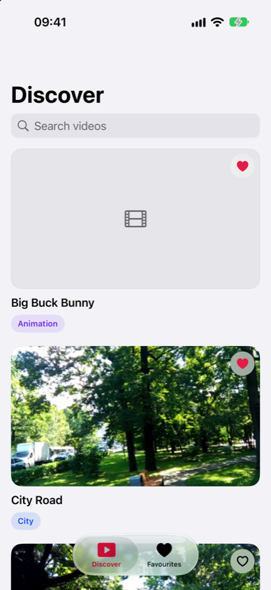
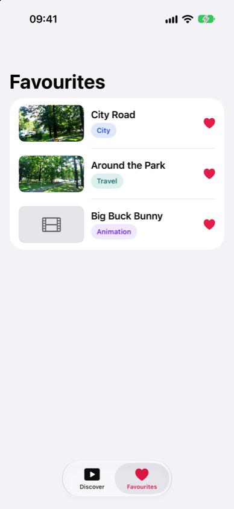
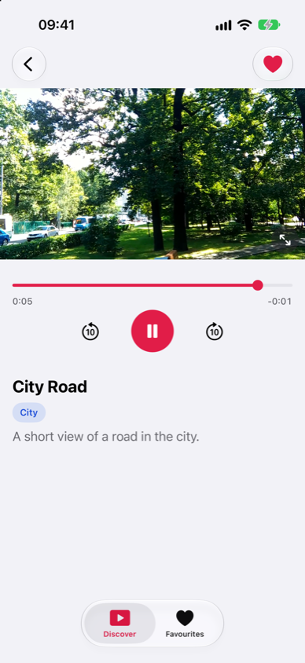
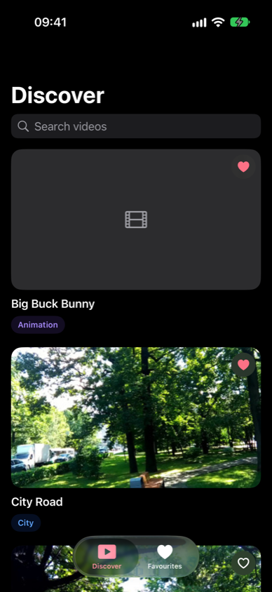

# Video Discovery

A SwiftUI app to browse, search, favourite and play videos from a remote catalogue.

| Discover | Favourites | Video Details | Dark mode |
|---|---|---|---|
|  |  |  |  |

## What the brief asked for, and where it lives

| Brief | How it works |
|---|---|
| Catalogue in one HTTP request | `DiscoverModel.load()` runs once from `RootView`; retry only after a failure |
| Show 3, reveal up to 3 more while scrolling, from fetched data | `revealMore()` widens a window over the fetched array when the feed's footer scrolls into view: 3 → 6 → 8 |
| Search titles across the whole catalogue | `displayedVideos` filters every fetched title, including ones not revealed yet |
| Open details, add or remove favourites from Discover | Card → detail push; heart on the card (it never triggers navigation) and in the detail toolbar |
| Favourites: list, remove, same detail screen | Inset list, newest first; swipe to remove or tap the heart; rows push the same `VideoDetailView` |
| Favourites consistent across tabs and persisted | One `FavoritesStore` in the environment, saved as JSON in Application Support |
| Each tab keeps its navigation state | Each tab's `NavigationStack` path lives in `RootView` |
| Title, category, description; remote video with custom controls | `AVPlayerLayer` with SwiftUI controls: scrubber, times, ±10 s, play/pause |
| Loading and playback-failure feedback | Spinner, delayed buffering spinner, "Can’t play this video" with Try again |
| Pause on leaving the screen, switching tabs, backgrounding | `onDisappear`, an `isTabActive` environment value and `scenePhase` |
| Loading, empty and error states with retry | Skeleton cards, "No videos yet", "Couldn’t load videos" with Try again, "No results" |
| SwiftLint in the build, config in the repo | Run Script build phase + `.swiftlint.yml` (0 violations, `--strict`) |
| Two focused unit tests | `DiscoverModelTests`, `FavoritesStoreTests` (Swift Testing) |

Added after testing on a device: the video starts when its detail screen first opens, pinch to
zoom, a full-screen player that follows the phone into landscape, and a media cache that lasts for
the session.

## Setup

- Xcode 16 or later (the project uses the Xcode 16 format). Built and tested with Xcode 27 on the
  iOS 27 simulator and an iPhone 15 Pro; the deployment target is iOS 17.
- SwiftLint: `brew install swiftlint`. It runs as a build phase; without it the build prints a
  warning and carries on.
- Open `VideoDiscovery.xcodeproj`, pick the `VideoDiscovery` scheme and an iPhone simulator, and run.
  No third-party dependencies. On a device, choose your own team under Signing & Capabilities.
- Tests: ⌘U, or

  ```bash
  xcodebuild test -project VideoDiscovery.xcodeproj -scheme VideoDiscovery \
    -destination "platform=iOS Simulator,name=iPhone 17"
  ```

### Trying every state

Debug builds read two launch arguments (Edit Scheme › Run › Arguments):

| Argument | Values | Effect |
|---|---|---|
| `-catalog-stub` | `loaded`, `empty`, `error`, `slow` | Replaces the network with canned data |
| `-favorites` | `none`, `sample` | Starts with no favourites or three saved videos |

"Unavailable Preview" in the catalogue points at a URL that returns an error, so it shows the
playback failure state. Airplane mode shows the catalogue error.

## Architecture

1. One app target, organised by feature: `App`, `Core`, `Shared`, `Features/Discover`,
   `Features/Favorites`, `Features/VideoDetail`.
2. MVVM-lite: screen logic lives in `@Observable @MainActor` models (`DiscoverModel`, `PlayerModel`);
   views stay thin.
3. Networking and persistence sit behind small protocols (`CatalogServicing`, `FavoritesPersisting`)
   injected through initialisers, so tests use fakes.
4. `FavoritesStore` is created once and shared with both tabs through the environment.
5. Each tab's `NavigationStack` path lives in `RootView`, so switching tabs never resets a stack.

```
VideoDiscovery/
  App/                  entry point, tabs, orientation lock, debug launch options
  Core/                 Video, catalogue service, favourites store and persistence, media cache
  Shared/               design tokens (Theme, Motion) and reusable views
  Features/Discover/    DiscoverModel, feed, cards
  Features/Favorites/   saved videos
  Features/VideoDetail/ PlayerModel, player surface, stage overlays, controls, zoom, full screen
VideoDiscoveryTests/    the two unit tests and a mock service
```

## Main decisions

- **One request, local paging.** The feed is a window over the fetched array. The next batch is
  revealed when a footer below the last card actually comes into view, so the first screen never
  reveals more before the user scrolls. Search ignores the window and shows every match.
- **Favourites keep a copy of each video**, so the Favourites tab works even when the catalogue
  request fails. Everything is keyed by `id`: two catalogue entries share one clip URL.
- **A custom player on `AVPlayerLayer`.** `VideoPlayer` ships system controls, so the controls are
  SwiftUI. `PlayerModel` is a small state machine (loading, ready, playing, paused, ended, failed)
  fed by Combine publishers on the main queue; pausing never hides an ended or failed state.
- **Pausing is explicit**: on disappear, when the tab stops being selected, and when the scene
  leaves the foreground. The video starts by itself only when its detail screen first opens; after
  a pause it waits for the user. The feed never autoplays.
- **Zoom and full screen.** Pinch the video to zoom (1×–3×, drag to pan, double-tap to reset). Full
  screen shares the same `PlayerModel`, opens in the current orientation and follows the phone into
  landscape with the system rotation animation; the rest of the app is portrait.
- **A session-scoped media cache.** Thumbnails stay in memory. A video streams on its first view and,
  once the stream is ready, is saved to a temporary folder in the background, so opening it again (or
  retrying offline) plays the local file. The
  folder is emptied at every launch (iOS gives no callback on a force-quit), so nothing outlives the
  session. Error responses are never saved.
- **A small design system, applied as tokens.** The look ("Quiet Cinema") was designed as a design
  system first: light and dark colours, type, spacing, radii and a motion spec. Tokens live in
  `Shared/Theme.swift`, timings in `Shared/Motion.swift`, and views use no literal colours. The
  structure stays native (`NavigationStack`, `TabView`, `List`, SF Symbols). Every animation turns
  into a plain fade with Reduce Motion.
- **SwiftLint as a Run Script phase** rather than the SPM plugin: nothing to trust or download, and
  the project stays dependency-free.
- **Swift 6 language mode** with strict concurrency; iOS 17 APIs only, iOS 18 extras (the card →
  detail zoom transition) behind availability checks.
- **Folder-synchronised groups:** adding a file to a folder adds it to the target.

## Assumptions

- Search is case- and diacritic-insensitive, trims whitespace and isn't paged.
- The search field sits under the large title, as designed. On iOS 26 and later an always-visible
  system search drawer collapses the large title, so the field is a small view at the top of the
  feed. Navigation and tab bars are the system ones (Liquid Glass on iOS 26+).
- Favourites are listed newest first.
- Pull-to-refresh is left out: the brief asks for a single catalogue request, and retry covers
  failures.
- The catalogue decodes as a whole: a malformed entry shows the error state rather than a partial
  feed.
- An unreadable favourites file is moved aside (`favorites.corrupt.json`) instead of being
  overwritten by the next save.
- English UI with British spelling, iPhone only.

## Tests

The brief asks for two focused tests; both use Swift Testing.

- `DiscoverModelTests`: the catalogue is requested once; the feed shows 3 → 6 → 8 videos from that
  data; search finds a video that hasn't been revealed yet.
- `FavoritesStoreTests`: favourites toggled in one store are read back by a fresh store from the
  same file, starting from a missing folder whose name has a space (as Application Support does on a
  fresh install).

## AI usage

The brief encourages AI tools, so I worked with Claude Code as a small team and kept the decisions
with me:

- **Brief and plan first.** The case became a requirement list and a step plan before any code. I
  made the product and technical calls in one pass.
- **Adversarial reviews.** A separate agent tried to break the plan before implementation and each
  larger change after it. Its findings became rules or fixes, for example creating Application
  Support before writing, delivering AVFoundation callbacks on the main queue, and a scrubber that
  stuttered on short clips.
- **Design.** I designed the screens and the "Quiet Cinema" design system in Claude Design. A first
  native-only pass is visible in the history; the final screens follow the design system's tokens and
  motion spec.
- **Parallel implementation.** The riskiest parts (player model, detail screen, media cache) were
  built by separate agents in their own git worktrees and merged once tests passed. Commits carry a
  `Co-Authored-By` line.
- **Testing.** I tested on the simulator and on an iPhone. Manual testing caught a bug the plan
  missed: favourites were saved but never loaded after a relaunch, because `URL.path()`
  percent-encodes the space in "Application Support". The favourites test now covers it.

## Time spent

About **2 h 30 min** in total, measured with a stopwatch that ran without a pause from receiving the
case to submission. Roughly:

| Part | Time |
|---|---|
| Reading the brief, planning, plan review | 35 min |
| Project setup, core logic, player model, tests | 35 min |
| Design: a first native pass, then the final design system and its screens | 45 min |
| Changes after device testing: autoplay, zoom, full screen, media cache | 25 min |
| Reviews, fixes and this README | 10 min |

The design iteration was the costliest part: the first pass was built native-only before the final
design system arrived, and its screens were then redone.

## Unfinished work and next steps

- **UI and snapshot tests** for each screen state; the debug launch arguments are there to drive
  them. Unit tests for the player's phase-to-UI mapping.
- **Larger layouts.** Apart from full screen the app is iPhone and portrait only; iPad and landscape
  would need their own layouts.
- **Player extras:** Picture in Picture, AirPlay, auto-hiding full-screen controls, remembering the
  playback position.
- **Caching:** the first view still downloads a video twice (the stream, then a copy for the cache);
  a resource-loader-based cache would share one download. `MediaCache` is a singleton over
  `URLSession.shared`; injecting its folder and downloader would make it unit-testable.
- **Localisation:** strings are English only and not yet in a String Catalog.
- Not run on an iOS 17 device; verified on iOS 27.
